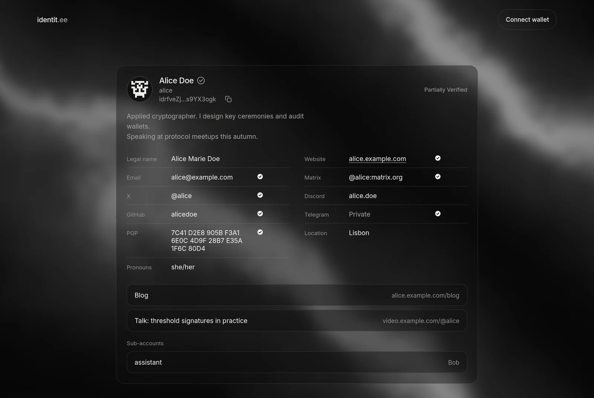
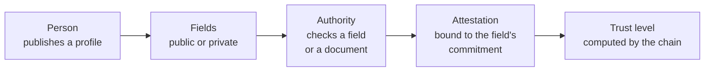
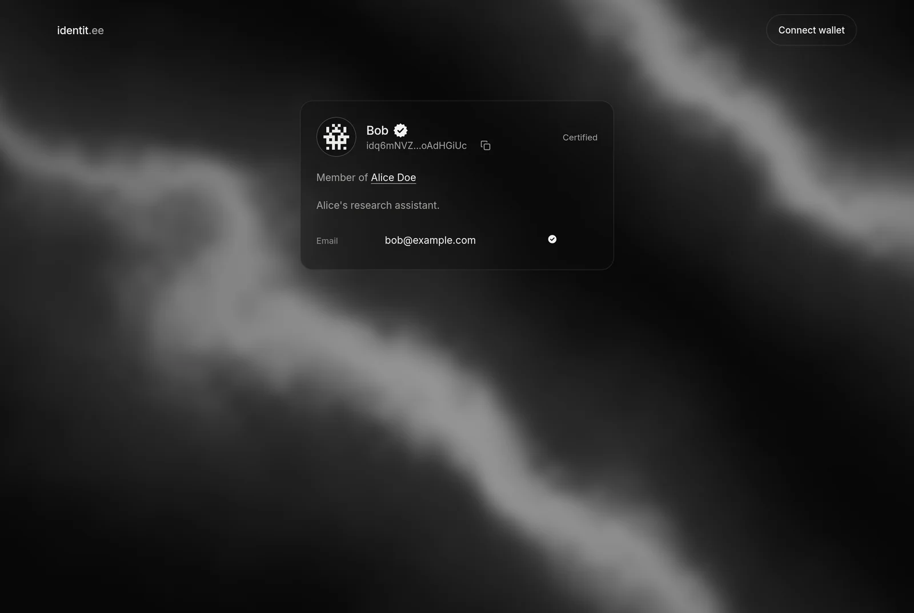
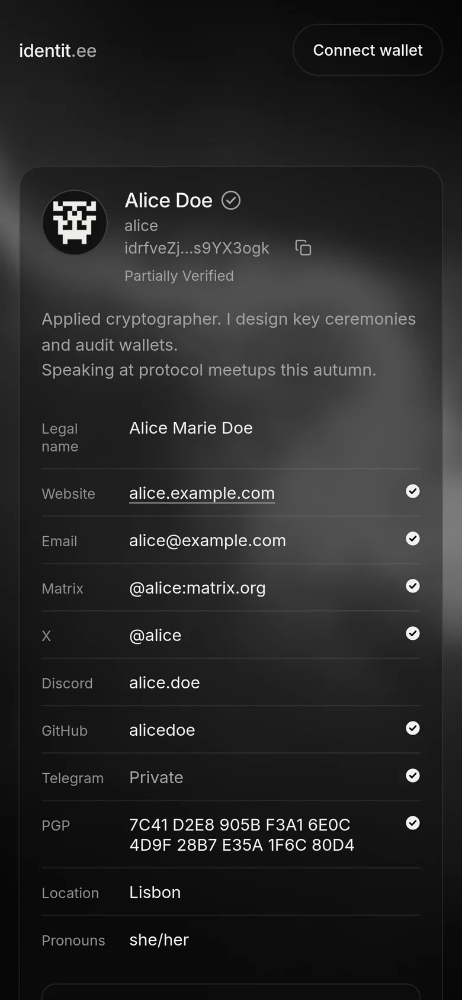

# identitee

<p align="center">
  
</p>

identitee is a blockchain dedicated to decentralized identity, built on the Polkadot SDK.

A person publishes a profile under their own account: a bio, an avatar, and fields such as an
email address, a website or social accounts. Each field is public or private. A private field is
stored as a salted commitment, and its owner decides who gets to see the value. Independent
identity authorities check fields and record facts, such as a passed document check, and the chain
derives a trust level for each identity from those attestations. A person can also hold a unique
username and link sub-accounts. An identity from the Polkadot or Kusama People Chain can be
brought over, judgements included.

Identity writes are feeless, so a new account can create its profile without holding tokens.
Per-account quotas protect the chain from abuse.

The public testnet runs at `wss://rpc.identit.ee`. Its web front, [identit.ee](https://identit.ee), is in restricted access while the testnet runs.

## How it works



1. A person writes their profile from the web front or any Polkadot wallet. Writes are feeless.
2. They ask an authority to check a field. The verification service handles email, X, Discord,
   GitHub, Telegram, Matrix, websites, PGP keys and identity documents automatically.
3. The authority records an attestation on chain. It is bound to the exact value it checked, so
   changing the field invalidates it.
4. Anyone reads the result: the chain derives the trust level from the attestations, from
   Declared to Certified.

| Trust level | Meaning |
|---|---|
| Declared | The profile exists, nothing is verified yet |
| Partially Verified | At least one field is verified |
| Fully Verified | Every verifiable field present is verified, and there is at least one |
| Certified | Fully Verified, and an authority checked an identity document |
| Fraudulent | An authority recorded a fraud finding |

<p align="center">
  
  &nbsp;
  
</p>

## Repository

| Path | Contents |
|---|---|
| `pallets/identitee` | The identity pallet: profiles, fields, authorities, attestations, trust levels, names, sub-accounts, migration, quotas |
| `runtime` | The chain runtime (Aura, GRANDPA, Balances, Sudo and the identity pallet) |
| `node` | The node binary, `identitee-node` |
| `tools` | TypeScript services and tooling: the People Chain migrator, the verification service, end-to-end scenarios |
| `web` | The web front, a Preact single-page application |
| `deploy` | Release build, systemd units, nginx configuration, backups, testnet chain spec |
| `docs` | Architecture, verification service, operations, manual testing, DID format |

## Documentation

- [Architecture](docs/ARCHITECTURE.md): the identity model and how the components fit together
- [Verification service](docs/VERIFIER.md): how fields and documents are checked and attested
- [Operations](docs/OPERATIONS.md): building, deploying and running a node and its services
- [Manual testing](docs/TESTING.md): exercising the chain from polkadot.js/apps
- [DID method](docs/DID.md): the planned `did:identitee` format
- [Tools](tools/README.md) and [web front](web/README.md): developer guides for each package

## Chain parameters

| Parameter | Value |
|---|---|
| Consensus | Aura (block production), GRANDPA (finality) |
| Block time | 6 seconds |
| SS58 prefix | 2426 (addresses start with `id`) |
| Token | `IDT`, 12 decimals |
| Polkadot SDK | `polkadot-stable2606-3` |

## Build and test

Prerequisites: the Rust toolchain pinned in `rust-toolchain.toml` (installed by `rustup` on first
use), `protobuf-compiler`, `clang`, `libclang-dev` and `libssl-dev`. The `tools` and `web` packages
need Node.js 24.

```bash
cargo build --release
cargo test --workspace

# a throwaway development chain on ws://127.0.0.1:9944
./target/release/identitee-node --dev --tmp
```

```bash
cd web && npm ci && VITE_RPC=ws://127.0.0.1:9944 npm run dev   # web front against the local node
cd tools && npm ci && npm test                                   # tools test suite
```

## Contributing

See [CONTRIBUTING.md](CONTRIBUTING.md). Report security issues privately, as described in [SECURITY.md](SECURITY.md).

## License

Copyright (C) 2026 Sigreturn Labs SAS.

identitee is free software, released under the [GNU Affero General Public License v3.0](LICENSE).
Files derived from the Polkadot SDK solochain template keep their original Apache-2.0 notice.
If you run a modified version as a network service, you must offer its source code to its users.
For other licensing terms, contact contact@sigreturn.com.
