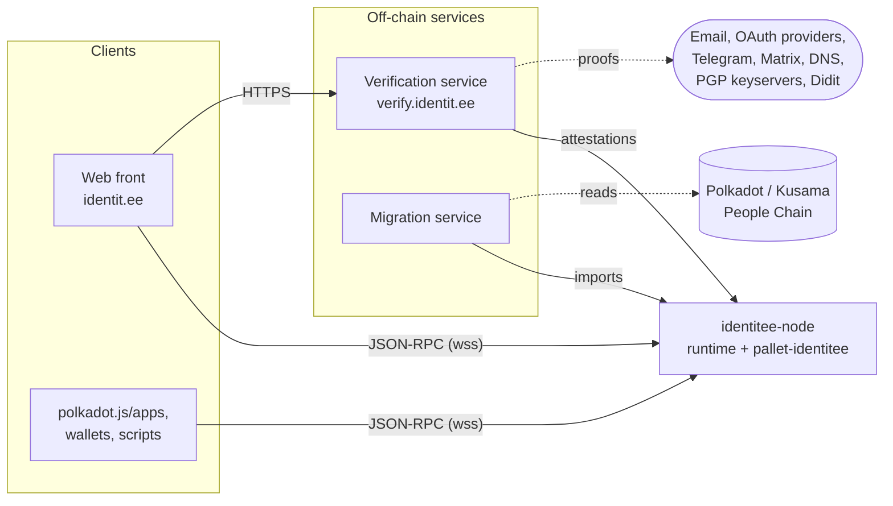
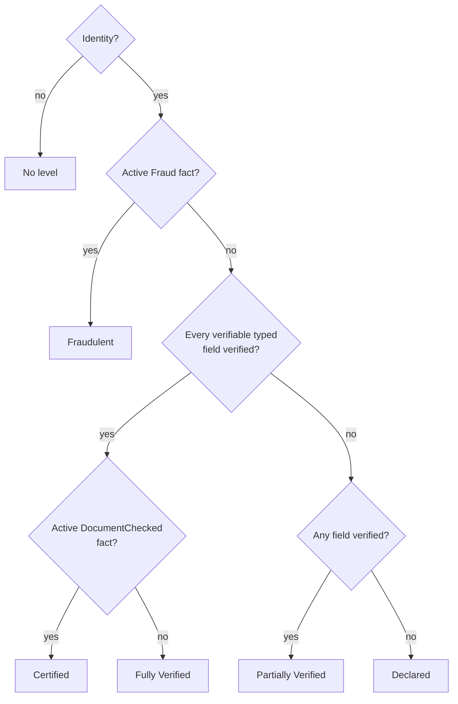

# Architecture

identitee is a Polkadot SDK solochain whose runtime carries one domain pallet, `pallet-identitee`.
This document describes the identity model that pallet implements and the off-chain components
around it. The pallet sources (`pallets/identitee/src/`) are the reference: each module opens with
the rules it enforces.

## Components



| Component | Path | Role |
|---|---|---|
| Node | `node/` | `identitee-node`: Aura block production, GRANDPA finality, JSON-RPC, chain spec presets |
| Runtime | `runtime/` | System, Timestamp, Aura, GRANDPA, Balances, TransactionPayment, Sudo, SkipFeelessPayment and Identitee; the `IdentiteeApi` runtime API; the `CheckNonceOnboard` transaction extension |
| Pallet | `pallets/identitee/` | Identities, fields, authorities, attestations, facts, trust levels, names, sub-accounts, migration, quotas, identity secret |
| Migration service | `tools/src/migrator.ts` | Off-chain agent with the migrate capability: serves `request_migration` by reading the People Chains |
| Verification service | `tools/src/verifier/` | Off-chain agent that attests fields and records document checks once a person proves control ([VERIFIER.md](VERIFIER.md)) |
| Web front | `web/` | Static Preact application: profiles, the identity editor, requests, names, sub-accounts, migration, and the authority page |

Clients talk to the chain only through the node's JSON-RPC: they submit signed extrinsics and read
state with the `IdentiteeApi` runtime API (`state_call("IdentiteeApi_<method>", ...)`), which returns
ready-made views so that no client has to decode storage. The two services are ordinary chain clients
that sign with their own agent keys.

### Chain parameters

| Parameter | Value |
|---|---|
| Block time | 6 s (Aura), finality by GRANDPA |
| SS58 prefix | 2426 (addresses start with `id`); not yet in the SS58 registry |
| Token | `IDT`, 12 decimals |
| Privileged origin | `Root` through `pallet-sudo` (`AuthorityOrigin = EnsureRoot`) |
| Quota window | 1 day (14,400 blocks) |
| Name quarantine | 30 days |

The transaction extensions keep the identifiers and encodings of the Parity solochain template, so
polkadot.js and standard wallets sign without custom types. `frame_system::AuthorizeCall` is unknown to
polkadot.js by name; it carries no data and the notice it prints is cosmetic.

## Accounts and identities

An identity is attached to one account (`AccountId32`) and stored in `Identities`. It holds:

| Part | Content | Limits |
|---|---|---|
| Typed fields | One value per `FieldKind`: `DisplayName`, `LegalName`, `Web`, `Email`, `Matrix`, `X`, `Discord`, `GitHub`, `Telegram`, `Pgp` | value 256 bytes; PGP is a raw 20-byte (v4) or 32-byte (v6) fingerprint |
| Custom fields | Free key and value | 16 fields, key 32 bytes, value 256 bytes |
| Links | Title and URL, with a stable id never reused within the identity, in display order | 16 links, title 64 bytes |
| Bio | UTF-8 text | 560 bytes |
| Avatar | WebP, exactly 64x64, checked from its headers | 8192 bytes |
| Timestamps | `created_at`, `updated_at` (block numbers) | |

Text is checked as UTF-8. Any field write creates the identity if it does not exist. Each part has its
own call (`set_bio`, `set_field`, `clear_field`, `add_link`, `update_link`, `remove_link`,
`reorder_links`, `set_avatar`, `clear_avatar`), and two batch calls apply many changes atomically:
`set_identity` (up to 32 field changes, a field at most once) and `update_profile` (secret, bio, avatar,
fields and the full link list in one call; an update that changes nothing is refused). Every write
emits an event, so the history of an identity can be rebuilt from events.

`clear_identity` deletes the identity with its attestations, pending requests, name (which goes into
quarantine) and the sub-account links it proposed. It keeps the facts authorities recorded about the
person, the migration history and the identity secret, which belong to the person or the account. The
account, its nonce and its provider reference survive, so old feeless transactions cannot be replayed.
`kill_identity` (Root) also deletes facts, migration history and identity secret.

## Fields: public, private, reveal

A field value is either `Public(bytes)` or `Private(commitment)`. Every value has a commitment, and
attestations bind to commitments, never to raw values:

| Kind | Commitment |
|---|---|
| Public value | `blake2_256("identitee:field:public:v1" ‖ value)` |
| Private value | `blake2_256("identitee:field:private:v1" ‖ salt ‖ value)`, computed by the client with a 32-byte salt |
| Link | `blake2_256("identitee:field:link:v1" ‖ SCALE((title, url)))` |

The three domain tags keep the kinds apart: no public value, private commitment or link can share the
commitment of another and inherit its attestations.

A private value never reaches the chain. Its owner discloses it, with its salt, to whoever should see
it: an authority checking the field receives a signed verification packet (value, salt, commitment,
field, account, genesis) and recomputes the commitment. `reveal_field(key, value, salt)` makes a
private field public; the chain checks the commitment, and the field's attestations are rebound to the
commitment of the public value, so they stay valid.

## Identity secret

An account may store one opaque blob of 1 to 256 bytes (`set_identity_secret`,
`clear_identity_secret`, read with `IdentiteeApi::identity_secret`). The chain never interprets it. The
web front uses it to hold, encrypted by a passphrase, the 32-byte secret from which it derives the salt
of every private field, so any device with the account and the passphrase finds the same salts:

```
blob           = 0x01 ‖ argon2 salt (16) ‖ nonce (24) ‖ XChaCha20-Poly1305(key, nonce, secret)
key            = Argon2id(NFC(passphrase), argon2 salt, m = 64 MiB, t = 3, p = 1)
salt of field  = blake2_256("identitee:salt:v1" ‖ secret ‖ SCALE(FieldKey))
```

The blob needs no identity and survives `clear_identity`.

## Authorities, agents and capabilities

An identity authority is an organisation registered by Root (`add_authority`), with a name and an
active flag. Ids are assigned from 0 and never reused; at most 16 authorities. An authority acts
through agents: accounts that serve exactly one authority and hold a set of capabilities
(`set_agent`, `remove_agent`, `set_authority_active`).

| Bit | Capability | Allows |
|---|---|---|
| 1 | `ATTEST_FIELDS` | `provide_judgement`, `revoke_attestation`, refusing field requests |
| 2 | `PERSON_FACTS` | `grant_fact`, `revoke_fact`, refusing fact requests |
| 4 | `MANAGE_NAMES` | `reserve_username`, `unreserve_username`, `set_username_for`, `unbind_username` |
| 8 | `MIGRATE` | `fulfil_migration`, `reject_migration` |

The agents of an inactive authority cannot act. Agent calls are feeless when the signer is an agent of
an active authority with the capability the call needs, and they never count against user quotas. The
name-management calls are also open to Root; only the agent path is feeless.

The testnet genesis registers authority 0, `identitee`, with three agents: the operator account
(all capabilities, also sudo), the migration service (`8`) and the verification service (`3`). The
development preset uses `//Alice` (all capabilities, sudo) and `//Bob` (`8`).

## Requests, attestations and facts

A person may ask an authority to check a field or to record a fact (`request_judgement(authority,
target)`, withdrawn with `cancel_request`); at most 16 pending requests per account. Requests are
optional: an agent can attest or grant without one, and doing so consumes the matching request.
`reject_request` refuses a request with a reason code and a note of up to 128 bytes.

A field attestation is stored per (account, field, authority):

| Element | Meaning |
|---|---|
| `commitment` | Commitment of the value the authority checked |
| `verdict` | `Verified`, or `Rejected` (checked and refused, for instance a disposable email) |
| `method` | `EmailCode`, `OAuth`, `MatrixChallenge`, `PgpSignature`, `Dns`, `WebFile`, `Manual`, `BotChallenge`, or `MigratedFromPeopleChain { source, registrar, block }` (set only by migration) |
| `issued_at`, `expires_at` | Blocks; an expiry must lie in the future |
| `revoked` | Block and reason code, if revoked |

`provide_judgement(who, key, expected_commitment, verdict, method, expires_at)` takes the commitment the
agent checked. If the field has changed since, the call fails with `StaleCommitment`, so an authority
can never attest a value it did not see.

An attestation is valid while it is not revoked, not expired, and the field still has the attested
commitment. Changing a field invalidates its attestations without deleting them: setting the same
value back makes them valid again. Removing a field or a link deletes its attestations. Attesting again
overwrites the authority's previous attestation of that field and clears a revocation.

A fact concerns the person, not a field. It is stored per (account, kind, authority) with an optional
expiry, a reason code, a UTF-8 note and a revocation:

| Fact | Meaning |
|---|---|
| `DocumentChecked` | The authority checked an identity document (KYC) |
| `Fraud` | The authority found fraud |

Facts outlive `clear_identity`, so a fraud finding cannot be erased by clearing and recreating the
identity. Only a revocation by the authority or `kill_identity` removes them.

## Trust levels

The trust level is computed on demand at the block it is read, never stored
(`IdentiteeApi::trust_level`, `pallets/identitee/src/trust.rs`). A field counts as verified when some
authority has a valid `Verified` attestation of it and no authority has a valid `Rejected` one.



| Order | Condition | Level |
|---|---|---|
| 1 | No identity | none |
| 2 | An active `Fraud` fact from any authority | `Fraudulent` |
| 3 | At least one verifiable typed field is present, every one present is verified, and an active `DocumentChecked` fact exists | `Certified` |
| 4 | As 3, without the document fact | `FullyVerified` |
| 5 | At least one present field of any kind (typed, custom, link) is verified | `PartiallyVerified` |
| 6 | Otherwise | `Declared` |

Verifiable typed fields are all typed fields except `DisplayName` and `LegalName`, which are
declarative. Names, bio, avatar, custom fields and links never block `FullyVerified`; a typed field
added or changed and not yet verified does. A document check alone, with no verified typed field, leaves
the level at `Declared`.

## Usernames

An identity may own one native name: 3 to 32 bytes of `a-z`, `0-9`, `-` and `_`. `NameOwner` and
`NameOf` hold the two directions of the relation; `IdentiteeApi::resolve_name` and `name_status` read
them.

| Rule | Behaviour |
|---|---|
| Claim | `claim_username` needs an identity with a verified field (as for the trust level), no name yet, no active `Fraud` fact, and a name that is valid, free, not reserved and out of quarantine |
| Keep | The attestation is only checked at claim time. A name stays if the attestation later lapses; names are not transferable |
| Release | `release_username` gives the name up |
| Quarantine | A name that leaves its owner (released, revoked, or identity cleared) cannot be claimed or assigned by anyone, former owner included, for 30 days |
| Cooldown | After a voluntary release the account cannot claim any name for one quota window (1 day), which stops claim and release loops from freezing names in quarantine |
| Reserved names | A manager reserves names (system words, brands) that nobody can claim. A reserved name is never owned |
| Assignment | `set_username_for` gives a name to an account with an identity and no name. It goes past the reservation (consuming it), the attestation requirement, the fraud rule and the cooldown, never the quarantine |
| Revocation | `unbind_username` takes a name away with a reason; it enters quarantine and the account may claim another at once |

Managers are Root or agents holding `MANAGE_NAMES`.

## Sub-accounts

A parent links other accounts to its identity, with the consent of each:

- The parent proposes (`add_sub(sub, label)`, label up to 64 bytes) and needs an identity. Nothing is
  linked until the sub accepts with its own transaction (`accept_sub(parent)`), so nobody can claim an
  account as theirs.
- A proposal does not tie the target down: any number of parents can propose the same account. An
  accepted link is a membership, and an account has at most one parent.
- The sub needs no identity of its own.
- The tree has one level: an accepted sub cannot have accepted subs, and an account with accepted subs
  cannot become one.
- At most 100 subs per parent, accepted and pending together.
- The parent ends a link or withdraws a proposal with `remove_sub` and relabels with `rename_sub`; the
  sub declines a proposal with `decline_sub` or leaves with `quit_sub`.
- Clearing the parent's identity drops everything it listed. Clearing a sub's identity leaves its link.

Reads: `IdentiteeApi::subs_of`, `pending_subs_of` and `parent_of`.

## Migration from the People Chain

A person without an identity can bring theirs over from the Polkadot or Kusama People Chain, opt-in
and once:

1. The account sends `request_migration(source)`; one pending request per account, withdrawn with
   `cancel_migration`.
2. The migration service, an agent with `MIGRATE`, follows finalized blocks, reads `IdentityOf` for
   that account on the source chain at a finalized block, and calls `fulfil_migration(who, source,
   block, block_hash, payload)`, or `reject_migration` when there is nothing to import.
3. The runtime checks the payload with the rules of user writes and refuses all of it on the first
   invalid entry, on a duplicate key or registrar, or if the account created an identity meanwhile.
   Imported fields are public; the source's `additional` fields become custom fields.

The runtime, not the service, maps the judgement, so the rule is public. The retained judgement is the
first verdict among the dotID registrars of the source chain (Polkadot `#5`; Kusama `#7`, then `#6`); a
level without a verdict never masks another index's verdict.

| dotID judgement | On identitee |
|---|---|
| `Reasonable` | `Verified` attestation of every imported field |
| `KnownGood` | The same, and a `DocumentChecked` fact |
| `LowQuality` | `Rejected` attestation of every imported field |
| `Erroneous` | A `Fraud` fact |
| `OutOfDate`, `Unknown`, `FeePaid` | History only |

Attestations and facts are written for the agent's authority with the method
`MigratedFromPeopleChain { source, registrar, block }` and no expiry, and count like any other. A fact
the authority already recorded about the person is never overwritten. The provenance (source chain,
block, block hash, every judgement as read) is kept in `ImportedHistory`, exposed in the profile view,
and announced in `MigrationFulfilled`, so anyone can check it against the source chain. An account with
a migration history cannot migrate again, which keeps a second import from restoring what an
authority revoked since; only `kill_identity` lifts that.

## Feeless calls and quotas

`pallet-balances` and transaction payment are present, but identity calls are feeless through
`#[pallet::feeless_if]` and `pallet-skip-feeless-payment` (every feeless call emits
`skipFeelessPayment.FeeSkipped`). A never-funded account can write: the runtime's `CheckNonceOnboard`
extension, which presents itself to wallets as the standard `CheckNonce`, accepts an account with no
providers when its call is feeless, then gives it a provider reference on its first such call.

User calls are limited so that free does not mean unbounded:

| Limit | Value |
|---|---|
| Per account | 50 feeless calls per window of 14,400 blocks (one day), the window opening at the account's first feeless call |
| Per block | 20 feeless user calls, all accounts together; a call over the cap is deferred to a later block |

A call over its quota is not feeless and is refused unless the account can pay. Usage is recorded when
the transaction is applied, outside dispatch, so a call whose dispatch fails still consumes quota.
Batch calls (`set_identity`, `update_profile`) count once. Which calls count is decided by an
exhaustive match in `quota.rs`, so every new call must be classified. Agent calls and Root calls never
touch these counters.

## Runtime API

| Method | Returns |
|---|---|
| `profile(who)` | The identity, its name, trust level, every attestation with its validity now, every fact with whether it is active, parent, accepted subs, migration provenance |
| `trust_level(who)` | The trust level, `None` without an identity |
| `resolve_name(name)` | The owning account |
| `name_status(name)` | `Invalid`, `Taken(account)`, `Reserved`, `Quarantined { until }` or `Available` |
| `subs_of(parent)`, `pending_subs_of(parent)`, `parent_of(sub)` | Sub-account links with labels |
| `identity_secret(who)` | The stored blob |

Every size limit is a pallet constant in the metadata (`MaxValueLen`, `MaxBioLen`, `QuotaPerWindow`,
`GlobalFeelessPerBlock`, ...), so clients read the values the runtime enforces.

## Known limitations

These hold on the current testnet and are open before a public launch:

- The per-account quota does not resist Sybil accounts: fresh addresses are free. The per-block cap
  bounds the damage; a budget of bytes written per block is not implemented.
- Weights are estimates, not benchmarks.
- The meaning of attestations and facts from a deactivated authority, and the powers granted to a
  third-party authority (name management, which authority's `Fraud` counts), are not yet bounded; any
  authority's `Fraud` fact counts today.
- The salt of a private field depends only on the identity secret and the field key. Once a salt is
  disclosed (by `reveal_field` or to an authority), a later private value under the same key can be
  guessed from its commitment.
- A refused migration leaves no state on chain, only the `MigrationRejected` event.
- `kill_identity` requires an identity, so facts about an account without one cannot be purged.
- SS58 prefix 2426 is not registered; genesis presets write keys in hexadecimal for that reason.
