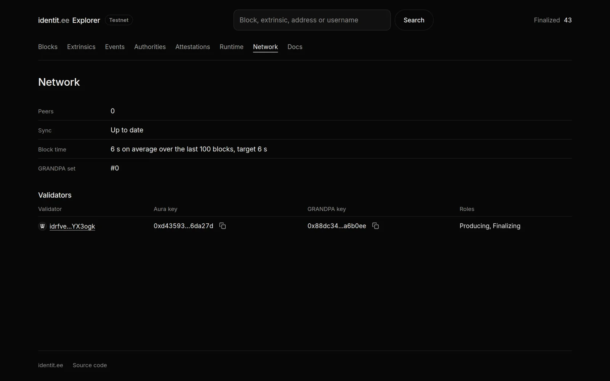

# Running a validator

This guide takes you from an empty Linux server to a validator of the identitee public testnet: it
produces blocks in turn with the other validators and votes for their finality. It is written for an
operator who is not the network's operator. The network's own node and services are covered in
[OPERATIONS.md](OPERATIONS.md).

## How validators work on identitee

- **The set is permissioned.** The validator set is a list of accounts kept by the validators pallet
  and changed by root (the network's sudo account). There is no staking and no election: the network's
  operator adds a validator once it has sent its keys.
- **Aura produces the blocks.** Time is cut into 6 second slots, and the validators take the slots in
  turn, in a fixed order. A validator that is offline leaves its slots empty: the block time stretches,
  nothing else breaks.
- **GRANDPA finalizes them.** A block is final once more than two thirds of the validators have voted
  for it. With two validators both must be online; with three, one can be away; with four, still one.
  When too many are away, blocks keep coming but finality waits, then catches up when they return.
- **Sessions last 10 minutes (100 blocks).** A change to the set takes effect at the start of the
  session after next, so within 20 minutes of being submitted.
- **Rewards.** The author of each block earns 10 IDT, minted for it, plus the transaction fees and
  tips of the block. A validator earns in proportion to the blocks it produces. Testnet IDT have no
  value.
- **Two kinds of keys.** Your *account* receives the rewards and identifies you in the set; it lives in
  your wallet, never on the server. Your *session keys*, an Aura key (sr25519) and a GRANDPA key
  (ed25519), sign blocks and votes; they live in the node's keystore.



## Requirements

| Item | Minimum |
|---|---|
| System | Linux x86_64 with glibc 2.35 or newer: Ubuntu 22.04+, Debian 12+ |
| CPU and memory | 2 cores, 4 GB of RAM |
| Disk | 40 GB of SSD; the testnet database is under 1 GB today and grows slowly |
| Network | A stable connection, outbound TCP; inbound TCP 30333 recommended |
| Clock | Synchronized by NTP: Aura slots are computed from the system clock |
| Uptime | A server that stays on: every hour offline is lost blocks, and with few validators, stalled finality |

A small cloud server is enough. Do not run a validator on a laptop or a machine that sleeps.

Check the clock now:

```bash
timedatectl | grep synchronized      # System clock synchronized: yes
```

## 1. Install the node

Each release on GitHub publishes the node binary, the runtime, the testnet chain spec and their
checksums, with a build provenance attestation. Use the latest release
(<https://github.com/sigreturn-labs/identitee-blockchain/releases>):

```bash
TAG=v0.1.0-runtime.11       # the latest release
URL=https://github.com/sigreturn-labs/identitee-blockchain/releases/download/$TAG
mkdir -p ~/identitee-$TAG && cd ~/identitee-$TAG
curl -fLO $URL/identitee-node-$TAG-linux-x86_64.tar.gz
curl -fLO $URL/identitee-testnet-raw.json
curl -fLO $URL/SHA256SUMS
sha256sum -c SHA256SUMS --ignore-missing          # both files: OK
```

Optionally, check that GitHub's build produced these files from this repository (needs the `gh` CLI):

```bash
gh attestation verify identitee-node-$TAG-linux-x86_64.tar.gz -R sigreturn-labs/identitee-blockchain
```

Install them:

```bash
tar -xzf identitee-node-$TAG-linux-x86_64.tar.gz
sudo install -m 755 identitee-node /usr/local/bin/identitee-node
sudo install -d -m 755 /etc/identitee
sudo install -m 644 identitee-testnet-raw.json /etc/identitee/
identitee-node --version
```

To build from source instead, see "Build and test" in the [README](../README.md): build the commit
of the release tag, on a system whose glibc is not newer than the server's.

## 2. Create the service user and directories

```bash
sudo useradd --system --no-create-home --home-dir /nonexistent --shell /usr/sbin/nologin identitee
sudo install -d -m 750 -o identitee -g identitee /var/lib/identitee
sudo install -d -m 700 /etc/identitee/secrets
```

`/var/lib/identitee` holds the chain database, the keystore and the network key.
`/etc/identitee/secrets` holds the phrase of your session keys, readable by root only.

## 3. Generate the network key

A validator needs a persistent network (libp2p) key; the node refuses `--validator` without one.

```bash
sudo /usr/local/bin/identitee-node key generate-node-key --file /var/lib/identitee/node-key
sudo chown identitee:identitee /var/lib/identitee/node-key && sudo chmod 600 /var/lib/identitee/node-key
sudo /usr/local/bin/identitee-node key inspect-node-key --file /var/lib/identitee/node-key   # your PeerId
```

## 4. Generate the session keys

Generate one secret phrase on the server, write it to a root-only file without displaying it, and
derive both session keys from it. Python 3 ships with Ubuntu and Debian:

```bash
B=/usr/local/bin/identitee-node; S=/etc/identitee/secrets; C=/etc/identitee/identitee-testnet-raw.json
sudo bash -c "umask 077; $B key generate --output-type json --words 24 \
  | python3 -c 'import json,sys; print(json.load(sys.stdin)[\"secretPhrase\"])' > $S/session.phrase"
sudo test -s $S/session.phrase && echo "phrase written"
```

Insert the keys into the node's keystore, then give it back to the service user:

```bash
sudo $B key insert --base-path /var/lib/identitee --chain $C --key-type aura --scheme sr25519 --suri $S/session.phrase
sudo $B key insert --base-path /var/lib/identitee --chain $C --key-type gran --scheme ed25519 --suri $S/session.phrase
sudo chown -R identitee:identitee /var/lib/identitee
```

Read the two public keys, filtering out the phrase that `key inspect` also prints:

```bash
sudo $B key inspect --scheme sr25519 $S/session.phrase | grep "Public key (hex)"   # Aura key
sudo $B key inspect --scheme ed25519 $S/session.phrase | grep "Public key (hex)"   # GRANDPA key
sudo ls /var/lib/identitee/chains/identitee_testnet/keystore/
# two files: 61757261<Aura key> and 6772616e<GRANDPA key>
```

The keystore file names must match the two public keys, without their `0x`.

Pitfalls:

- `--suri <path>` reads the file only if the path exists. A mistyped path is taken as a phrase, which
  derives the keys of the public development phrase, without any error. Always compare the keystore
  file names with the public keys read from the phrase file.
- Never print the phrase, paste it into a chat or a ticket, or keep it in the shell history. Anyone
  holding it can sign blocks as you.
- Never run two nodes with the same session keys at the same time. Both would author blocks in the
  same slots and cast conflicting GRANDPA votes, which forks the chain and can stall finality. When
  moving to a new server, stop the old node before starting the new one.

## 5. Back up your keys

Copy `/etc/identitee/secrets/session.phrase` and `/var/lib/identitee/node-key` somewhere safe, off
the server and encrypted (a password manager, an encrypted USB key). With the phrase you can rebuild
the validator on any server. Without it, you need new keys and the network's operator has to register
them again.

The chain database needs no backup: a new node syncs it from the network.

## 6. Install the service

`deploy/identitee-validator.service` is a hardened systemd unit for a validator. Install it, put your
validator's name in it (public, shown to peers), and start the node:

```bash
sudo curl -fLo /etc/systemd/system/identitee-node.service \
  https://raw.githubusercontent.com/sigreturn-labs/identitee-blockchain/master/deploy/identitee-validator.service
sudo sed -i 's/<your-validator-name>/my-validator/' /etc/systemd/system/identitee-node.service
sudo systemctl daemon-reload && sudo systemctl enable --now identitee-node
sudo journalctl -u identitee-node -f
```

What the unit sets:

| Option | Why |
|---|---|
| `--validator` | Author blocks and vote, once the keys are in the active set |
| `--node-key-file` | The persistent network key of step 3 |
| `--bootnodes` | The network's node, to find peers: the chain spec carries no boot node |
| `--listen-addr /ip4/0.0.0.0/tcp/30333` | P2P on every interface |
| `--rpc-port 9944 --rpc-methods safe` | RPC on localhost only, without the methods that insert or rotate keys |

Do not add `--rpc-external`, `--unsafe-rpc-external` or `--rpc-methods unsafe`: the RPC of a
validator must never be reachable from outside. Do not add `--force-authoring` either: a validator
cut off from its peers would keep producing blocks on its own fork.

Open the P2P port, keeping SSH:

```bash
sudo ufw allow OpenSSH && sudo ufw allow 30333/tcp && sudo ufw enable
```

Inbound P2P is not strictly needed, since the node connects out to its peers, but it lets the other
nodes reach you and keeps the network well connected.

## 7. Wait for the sync

The log shows the node syncing, then following the chain:

```
⚙️  Syncing 180.4 bps, target=#123456 (1 peers), best: #45000 ...
💤 Idle (1 peers), best: #123456 (0xab12…), finalized #123454 (0xcd34…)
```

`peers` must be at least 1, and `best` close to the explorer's latest block
(<https://explorer.identit.ee>). You can also ask the node:

```bash
curl -s -H 'Content-Type: application/json' \
  -d '{"id":1,"jsonrpc":"2.0","method":"system_health","params":[]}' http://127.0.0.1:9944
# "isSyncing":false, "peers" >= 1
```

The node is now a full node that holds your keys. It produces nothing until it joins the set.

## 8. Prepare your account

Create an account in a Polkadot wallet (Talisman, SubWallet, Polkadot.js extension), on the
identitee network. Its address starts with `id`. This account:

- receives the rewards of the blocks you produce;
- names you in the validator set, and in the explorer;
- needs no balance to be registered.

Keep it in your wallet. Its phrase never goes on the server. If you want a profile on it, set one on
[identit.ee](https://identit.ee): the explorer then shows your name and avatar next to your blocks.

## 9. Ask to join

Send the network's operator, at contact@sigreturn.com:

- your account address (`id...`);
- your Aura public key (`0x...`, step 4);
- your GRANDPA public key (`0x...`, step 4);
- your PeerId (step 3), and your validator's name.

These are public values: an e-mail is fine. Never send the phrase.

The operator submits, from the sudo account:

```
sudo(validators.addValidator(<your account>, { aura: <Aura key>, grandpa: <GRANDPA key> }))
```

Root vouches for the keys, so no proof of ownership is needed. The change takes effect at the start
of the session after next, within 20 minutes.

## 10. Check that you validate

Once the set includes you, the log shows your node preparing blocks in its slots:

```
🙌 Starting consensus session on top of parent 0x...
🎁 Prepared block for proposing at 123460 (2 ms) ...
🔖 Pre-sealed block for proposal at 123460 ...
🏆 Imported #123460 ...
```

And in the explorer:

- the **Network** page lists your account among the validators, with your Aura and GRANDPA keys and
  the roles Producing and Finalizing;
- the **Blocks** list shows your account as the producer of one block in N, N being the size of the
  set;
- your account's page shows its balance growing by 10 IDT per block produced, plus fees.

## Running it day to day

### Monitoring

```bash
systemctl is-active identitee-node
sudo journalctl -u identitee-node --since "10 min ago" | grep -E "Prepared block|Idle"
curl -s -H 'Content-Type: application/json' \
  -d '{"id":1,"jsonrpc":"2.0","method":"system_health","params":[]}' http://127.0.0.1:9944
```

The node also exposes Prometheus metrics on `127.0.0.1:9615/metrics`, for example
`substrate_block_height{status="best"}` and `{status="finalized"}`, and `substrate_sync_peers`.

Watch three things: the node is active, it has at least one peer, and `best` and `finalized` advance.

### Planned downtime

Tell the network's operator before a planned interruption: with few validators, your absence stops
finality. Restarting the node takes a few seconds and costs at most a slot or two.

### Upgrading the node

Two kinds of upgrades:

- **Runtime upgrades** are applied on chain by the network's operator (`system.setCode`). Your node
  picks the new runtime up by itself, with no action on your side.
- **Node upgrades** are new binaries, announced as GitHub releases. Install them when a release asks
  for it, or when the runtime needs a newer node:

  ```bash
  # download and check the new release as in step 1, then:
  sudo systemctl stop identitee-node
  sudo install -m 755 identitee-node /usr/local/bin/identitee-node
  sudo systemctl start identitee-node
  ```

  The database, keystore and network key stay as they are.

### Testnet resets

The testnet may be restarted from a new genesis. A reset comes with a new chain spec in the release.
Your keys survive; only the database goes:

```bash
sudo systemctl stop identitee-node
sudo install -m 644 identitee-testnet-raw.json /etc/identitee/      # the new chain spec
sudo -u identitee /usr/local/bin/identitee-node purge-chain -y \
  --chain /etc/identitee/identitee-testnet-raw.json --base-path /var/lib/identitee
sudo systemctl start identitee-node
```

`purge-chain` erases the database only. The network's operator registers the validators again on
the new chain, or puts them in its genesis.

### Moving to a new server

1. Install the node on the new server (steps 1 to 3, 6), without starting it.
2. Restore `session.phrase` and insert the keys (step 4); restore `node-key` to keep your PeerId.
3. Stop the old node, and only then start the new one. Never both at once.
4. Erase the keys on the old server: `/var/lib/identitee` and `/etc/identitee/secrets`.

### Changing keys

If your session keys may have leaked, stop the node, generate new keys (step 4, after removing the
old keystore files), and send the new public keys to the network's operator. The operator removes you from the set and
adds you again with the new keys; each change takes effect at the start of the session after next.

### Leaving the set

Ask the network's operator to remove you (`validators.removeValidator`). Keep the node running until
the change takes effect, within 20 minutes, then stop it and erase its keys. Stopping first would
leave your slots empty and, with few validators, stall finality in the meantime.

## Troubleshooting

| Symptom | Cause and fix |
|---|---|
| `0 peers` | The node cannot reach the boot node: check outbound TCP to `rpc.identit.ee:30333` and the `--bootnodes` address |
| `Starting an authorithy without network key` | The network key is missing or unreadable: step 3, owner `identitee`, mode 600 |
| Synced but never `Prepared block` | Not in the active set yet (wait two sessions, check the Network page), or the keystore holds other keys than the ones registered: compare the keystore file names with the keys you sent |
| Keys in the keystore look like the development ones | `--suri` was given a path that did not exist: remove the keystore files and redo step 4 |
| `Prepared block` then the block is not imported by others | Clock drift: check `timedatectl`; the slot is computed from the clock |
| Blocks advance but `finalized` is stuck | Not enough validators online for GRANDPA's two thirds; it resumes and catches up when they return |
| `Permission denied` in the log after a manual command | A file under `/var/lib/identitee` belongs to root: `sudo chown -R identitee:identitee /var/lib/identitee` |
| `RPC call is unsafe to be called externally` | Expected: the unit serves safe methods only; keys are inserted with `key insert`, not through RPC |

For anything else, contact the network's operator at contact@sigreturn.com with the last lines of
`journalctl -u identitee-node`, after checking that they contain no secret.
