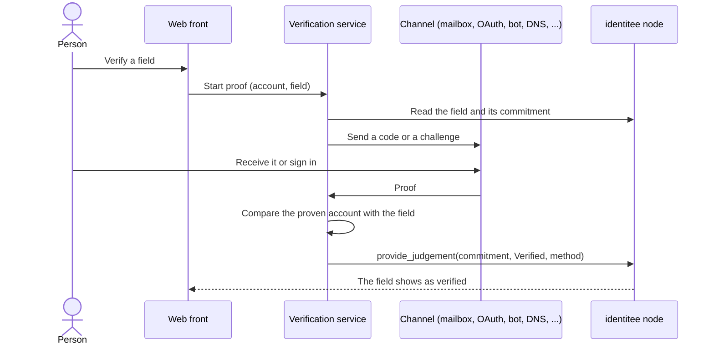

# Verification service

`identitee-verifier` lets a person prove, from the profile editor of the web front, that they control
a field of their identity, or pass an identity document check. Once the proof holds, the service
records it on chain with its own agent key. The person signs no transaction to be verified.

Code: `tools/src/verifier/`. Developer reference (every route, request and response):
[tools/README.md](../tools/README.md). Deployment: [OPERATIONS.md](OPERATIONS.md).

## What it attests

| Field or check | Channel | Proof | On chain |
|---|---|---|---|
| Email | `email` | A 6-digit code sent to the address | `provide_judgement`, method `EmailCode` |
| X | `x` | OAuth 2 sign-in | `OAuth` |
| Discord | `discord` | OAuth 2 sign-in | `OAuth` |
| GitHub | `github` | OAuth sign-in | `OAuth` |
| Telegram | `telegram` | A code from the service's bot, received by the account the field names | `BotChallenge` |
| Matrix | `matrix` | A code from the service's bot, posted in a private encrypted room with the account the field names | `MatrixChallenge` |
| Web | `web` | A file under `/.well-known/` or a DNS TXT record holding the account's address | `WebFile` or `Dns` |
| PGP | `pgp` | A signature of a one-time challenge by the key whose fingerprint the field holds | `PgpSignature` |
| Identity document | `kyc` | A document and selfie check at Didit | `grant_fact(DocumentChecked)` |

Every field attestation is `provide_judgement(who, key, commitment, Verified, method, None)`, where
`commitment` is the one the service read when the proof started. If the field changes before the
attestation lands, the runtime refuses it (`StaleCommitment`) and the person is asked to verify again.

The service never records `Rejected` verdicts or `Fraud` facts: a failed proof writes nothing, and the
person corrects the value and tries again. Fraud findings, custom fields and links stay manual work for
an authority agent, through `request_judgement` and the authority page. `DisplayName` and `LegalName`
are not verifiable.

## How a verification runs



## Common rules

- The chain is the only source of a value. The service reads the field from the node
  (`IdentiteeApi::profile`), never from the browser, except for a private field, whose value comes in a
  signed packet checked against the on-chain commitment.
- Account names are compared without case, without spaces and without a leading `@`. A Discord value
  made of digits matches the numeric id. Matrix compares the full `@local:server` id. A value written as
  the profile URL on the provider's own host (`x.com/<h>`, `twitter.com/<h>`, `github.com/<h>`,
  `t.me/<h>`, `matrix.to/#/@user:server`) is read as that handle.
- A public field needs no signature from its owner: proving control of the account is the proof. A
  third party can at most trigger a code to the owner's address, which per-mailbox limits bound.
- Submissions go one at a time, so the agent's nonce is never contended.
- A channel whose configuration is missing is disabled: its routes answer 503 "This verification is not
  available yet." and the rest of the service runs. `GET /api/health` returns the genesis and the
  enabled channels.

## Channels

### Email

1. `POST /api/email/send` reads the email on chain and sends a 6-digit code through Resend, valid
   10 minutes. The response carries a random `session` held only by the requesting browser.
2. `POST /api/email/check` with the session and the code attests the field.

Each send creates its own code bound to its session, with 5 tries, so nobody else can burn or replace
the owner's code. Disposable mailboxes are refused, judged by the domain and its MX hosts against a
fixed list; a DNS failure lets the email through. Aliasing forwarders (SimpleLogin, addy.io, Apple and
Firefox relays) are accepted because they front real inboxes.

### X, Discord, GitHub (OAuth)

`GET /oauth/<provider>/start` sends the browser to the provider with a random state (taken once,
10 minutes) and PKCE S256, and sets a `__Host-` cookie whose hash the state keeps. The callback refuses
a browser without that cookie, so a forwarded authorize link finishes nothing. It then reads the signed-in
account (X `username`, Discord `username` or id, GitHub `login`) and compares it with the field.

| Provider | Scopes |
|---|---|
| X | `users.read tweet.read` |
| Discord | `identify` |
| GitHub | none (public profile) |

A start is accepted only as a navigation opened by the site (`Sec-Fetch-Site` same-site or
same-origin, `Sec-Fetch-Dest: document`); a typed or forwarded start link is refused before any state
exists. The result returns as a `postMessage` to the site's origin only (popup) or a redirect to
`<front>/me` (mobile). The access token is used for one call and dropped.

### Telegram and Matrix (bot code)

The two bots share one flow:

1. `POST /api/<channel>/start` returns a one-time token (10 minutes) and a session kept by the page.
2. The person hands the token to the bot from the account the field names: Telegram through
   `https://t.me/<bot>?start=<token>`, Matrix by sending `!identitee <token>` to the bot in a direct
   message.
3. The bot checks that the sender is the account on chain and that the field is unchanged, then replies
   with a 6-digit code. It never names the identity it would verify.
4. The person types the code on the page that started; `POST /api/<channel>/check` attests the field
   and the bot confirms in the chat.

A forwarded token gives its receiver a code that only works under the session of the browser that
started, so forwarding achieves nothing.

Telegram: the bot long-polls `getUpdates`, answers private chats only, and removes any webhook at
startup. Matrix: the bot reads encrypted direct messages (Rust crypto store). It never posts the code in
the room where the command arrived, since whoever created that room could read it later. It creates a
new private, encrypted, invite-only room, invites the sender alone, and posts the code once the sender
has joined and nobody else is in it. It joins direct invites only and leaves rooms with more than two
members.

### Website

`POST /api/web/check` takes the host of the Web URL on chain and accepts either proof:

| Method | Proof |
|---|---|
| `WebFile` | `https://<host>/.well-known/identitee.txt` contains the account's address as a whitespace-separated word |
| `Dns` | A TXT record `identitee=<address>` on `_identitee.<host>`, or on `<host>` |

Any SS58 prefix of the address is accepted. The value must be a plain `[https://]<host>[:443][/path]`:
credentials, another scheme or port, queries, fragments and ambiguous forms are refused, and IP
addresses are not hosts. The fetch resolves the host itself, refuses loopback, private, link-local,
CGNAT, multicast, documentation and reserved addresses (IPv4-mapped and translated IPv6 forms judged
by their IPv4), and connects to the checked address: HTTPS on port 443 only, 5 s, 4 KB, at most three
redirects to the same host, no cookies. A private Web field is not verified, since fetching it would
tell the site's owner who is looking.

### PGP

`POST /api/pgp/challenge` returns one line valid 15 minutes:

```
identitee verification: link this key to identity <address> on chain <first 10 hex of the genesis> nonce <32 hex>
```

The person signs it (`gpg --clearsign`, or a detached armored signature) and posts the result to
`POST /api/pgp/verify`. The signature is checked over the stored challenge, never over the pasted text.
The key is fetched by fingerprint from `keys.openpgp.org` and merged with any public key the person
pastes. Its fingerprint must equal the on-chain one (v4 or v6); the primary key or a signing subkey may
sign; expired and revoked keys are refused. For a private fingerprint the keyserver is never asked,
since the request would reveal the value: the person must paste the public key, and only revocations
inside that key are seen.

### Identity document (Didit)

1. `POST /api/kyc/start` requires the account's wallet signature of
   `identitee kyc\nchain: <genesis>\naddress: <address>\ntime: <unix ms>`, less than 5 minutes old and
   usable once, so nobody can certify someone else's address with their own document. The account
   needs an identity and no active `DocumentChecked` fact. The service creates a Didit session tied to
   the address and returns its URL.
2. The browser's return to the site decides nothing. Only `POST /didit/webhook` acts: its HMAC-SHA256
   signature over the raw body must match and its timestamp must be within 10 minutes.
3. In the background the service fetches the decision from Didit itself, checks that it belongs to the
   session's address, and acts on its status alone: `Approved` grants `DocumentChecked`.
4. The session and the Didit user are then deleted at Didit.

One document certifies one address: the document number and issuing state become an HMAC mapped to the
address they certified, and a document already used for another address is declined. An approval
without a readable document number and state is not granted; it waits for an operator to review it in
Didit's console and grant the fact by hand. A sweep every 5 minutes retries failed grants and
deletions and polls sessions whose webhook never came; unfinished sessions are abandoned after 24 hours,
sessions in review after 7 days. `GET /api/kyc/status` reports `none`, `pending`, `approved` or
`declined`.

## Private fields

The service cannot read a private value. To verify one, the web front, with the identity secret
unlocked, builds a verification packet: the value, its salt, the commitment, the field, the account and
the genesis, signed by the wallet as a message (`signRaw`, not a transaction). The service checks:

- the signature is the account's;
- the packet names the same field and the same chain;
- the field is still private on chain;
- `blake2_256("identitee:field:private:v1" ‖ salt ‖ value)` equals the on-chain commitment.

The channel then runs on that value, and the attestation binds to the private commitment, so the value
never appears on chain. A checked packet is kept in process memory for 10 minutes under a random id
(`POST /api/packet`), never written to the database and never logged.

## Rate limits

Limits live in the database, so they survive restarts.

| Limit | Value |
|---|---|
| Proof starts per IP, all channels | 30 per hour |
| Email codes delivered | 5 per hour per (IP, account), and per mailbox (`+tag`, Gmail dots and case folded) |
| Wrong email or bot codes | 5 per code; 10 per hour per account (and per mailbox for email) |
| Telegram `/start` links | 10 per hour per Telegram user |
| Matrix commands | 10 per hour per sender; 20 room joins per hour per inviter |
| Website checks | 10 per hour per (IP, account) |
| PGP verifications | 5 tries per challenge; 60 per hour per IP |
| Packets checked | 30 per hour per IP |
| KYC sessions | 3 per day per (IP, address) |

Per-account limits are keyed with the IP so that a third party cannot lock the owner out.

## State

One SQLite file, `verifier.db`, in the service's state directory, holds pending challenges (email
codes, bot tokens and codes, PGP challenges, OAuth states, KYC sessions) with their expiry, the Telegram
polling offset, and rate-limit hits. Codes, tokens, row ids, mailbox keys, account handles and document
numbers are stored as HMACs or hashes under per-channel keys kept beside the database
(`email.key`, `telegram.key`, `matrix.key`, `pgp.key`, `didit.key`, mode 0600), so reading
`verifier.db` alone reveals no live code and no account name. Private values, documents and KYC data
are never stored; of a Didit decision only the status, the session id, the address and timestamps are
kept. The Matrix bot keeps its session, sync state and crypto store in `matrix/`.

## Security properties

- No attestation on the browser's word: each one follows a check made by the server.
- An attestation always names the commitment the service saw, so a value changed mid-proof is refused
  by the chain.
- A third party cannot complete a flow started by someone else: codes are bound to the starting
  browser's session, OAuth to its cookie, KYC to the account's signature.
- Logs are one JSON object per line and contain no secret: configured secrets are stripped from every
  line, and codes, tokens, sessions, private values and pasted keys are never logged.
- The HTTP API answers CORS only for the site origin (and localhost in development mode). Bodies are
  limited to 16 KB, 192 KB for PGP verification and 1 MB for the Didit webhook.
- The per-IP limits trust only the last `X-Forwarded-For` entry and only from a loopback peer: the
  reverse proxy must set that header to the client address alone.
- The agent holds capabilities `3` (attest fields, person facts) and nothing else: it cannot manage
  names, migrate or change authorities.

## Configuration

| Variable | Purpose |
|---|---|
| `IDENTITEE_VERIFIER_SURI` | Secret URI of the agent (required) |
| `IDENTITEE_WS` | Node endpoint, default `ws://127.0.0.1:9944` |
| `VERIFIER_PORT` | HTTP port on 127.0.0.1, default 8787 |
| `STATE_DIRECTORY` | Directory of `verifier.db` and the keys (set by systemd `StateDirectory=`) |
| `VERIFIER_FRONT_ORIGIN` | The site, where OAuth results go (default `https://identit.ee`) |
| `VERIFIER_PUBLIC_URL` | Public base URL of the service, for OAuth callbacks (default `https://verify.identit.ee`) |
| `VERIFIER_DEV` | `1` allows localhost origins and a local state directory |

| Channel | Variables |
|---|---|
| Email | `RESEND_API_KEY` |
| X, Discord, GitHub | `X_CLIENT_ID`, `X_CLIENT_SECRET`, `DISCORD_CLIENT_ID`, `DISCORD_CLIENT_SECRET`, `GITHUB_CLIENT_ID`, `GITHUB_CLIENT_SECRET` |
| Telegram | `TELEGRAM_BOT_TOKEN`, `TELEGRAM_BOT_USERNAME` |
| Matrix | `MATRIX_HOMESERVER`, `MATRIX_USER`, `MATRIX_PASSWORD` |
| Didit | `DIDIT_API_KEY`, `DIDIT_WORKFLOW_ID`, `DIDIT_WEBHOOK_SECRET` |
| Web, PGP | none |

URLs to register with providers, under `VERIFIER_PUBLIC_URL`: `/oauth/x/callback`,
`/oauth/discord/callback`, `/oauth/github/callback`, and the Didit webhook `/didit/webhook`.

The Matrix channel needs the native crypto module of `@matrix-org/matrix-sdk-crypto-nodejs`, pinned
by `tools/matrix-crypto.sha256` and checked with `npm run verify:native`. When it is missing or
altered, the service logs `matrix-crypto-missing` and runs without Matrix.

## Known limitations

- Starting a KYC check accepts a raw 64-byte signature or the sr25519 `MultiSignature` form only;
  ecdsa accounts cannot start it.
- `GET /api/kyc/status` is public: anyone can see whether an address has a pending or declined check.
- The 5-per-hour mailbox limit lets a third party delay a public email's owner for up to an hour.
- OAuth starts depend on fetch metadata headers; a browser or in-app view without them is refused.
- The Matrix bot's device is not cross-signed. If a client refuses to share keys with it, the
  command cannot be read and the bot asks the person to resend it or use an unencrypted chat.
