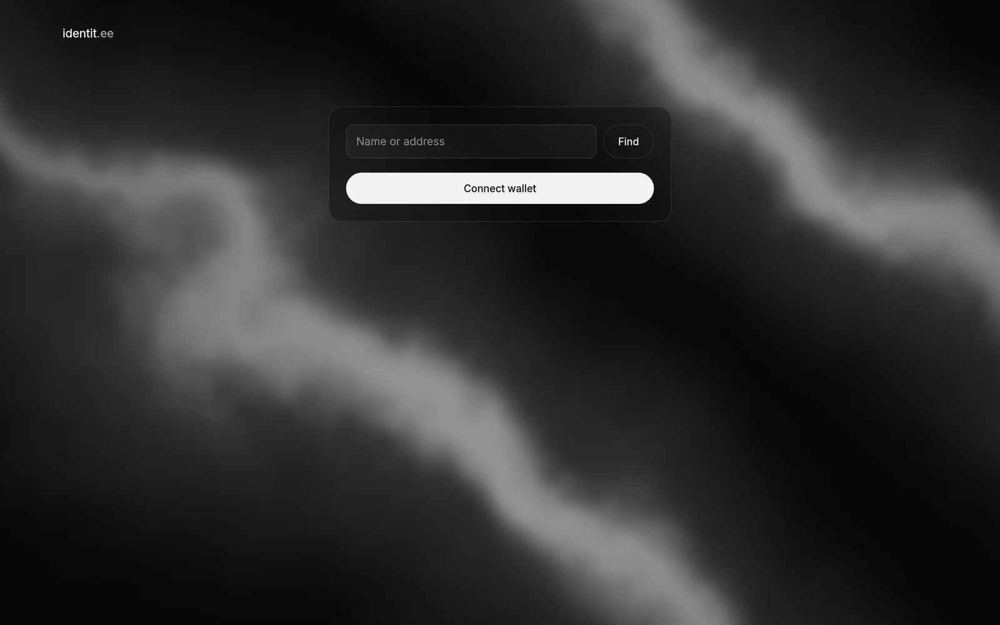

# identit.ee web front

<p align="center">
  
</p>

The browser front of the identitee chain, served at identit.ee. It connects a Polkadot wallet
extension, shows public profiles, lets an account edit its own identity (public and private fields,
bio, links, avatar), request verifications, claim a username, link sub-accounts and migrate an
identity from a People Chain. Authority agents get a work page for the requests sent to them.

It is a static single page application: everything is read from the chain through its RPC node and
written as signed extrinsics. The only other service it talks to is the verification service
(see [docs/VERIFIER.md](../docs/VERIFIER.md)).

## Stack

- Preact with `preact-iso` for routing, TypeScript, Vite (Rolldown) for the build.
- `@polkadot/api` and `@polkadot/extension-dapp` for the chain and the wallet.
- `@noble/hashes` and `@noble/ciphers` for commitments and the identity secret, `hash-wasm` for
  Argon2id, `@jsquash/webp` as a WebP encoder fallback.
- Vitest with happy-dom for tests, puppeteer-core for the end-to-end scripts.
- Node 24. Dependency versions are exact (`.npmrc` sets `save-exact`).

## Layout

```
src/
  app.tsx, main.tsx   routes and entry point; every page is lazy-loaded (ui/lazy-page.tsx)
  routes.ts           reserved paths (/me, /requests, /authority, /a), compared with app.tsx by a test
  chain/              everything that talks to the chain or the verification service
    api.ts            the shared connection (VITE_RPC), refuses a node that is not identitee
    tx.ts             signs and sends, turns pallet errors into English sentences
    calls.ts          the extrinsics built by the pages, checked before anything is signed
    identity.ts       profile, names and sub-accounts through the IdentiteeApi runtime API
    formulas.ts       field commitments, tested against vectors printed by the runtime
    requests.ts, overview.ts, naming.ts, migration.ts, subs.ts   the /requests page's data
    agent.ts, inbox.ts, packet.ts                                the /authority page's data
    verify.ts         client of the verification service (VITE_VERIFIER)
    wallet.ts         extension accounts and signers; remembered.ts stores the chosen address
  crypto/             identity secret: Argon2id key, XChaCha20-Poly1305 blob, per-field salts
  media/webp.ts       avatar crop and encoding, a port of the runtime's validate_avatar
  pages/              one file per page or page section (profile, me-*, requests-*, authority-*)
  ui/                 shared components, the WebGL background (silk.ts), tokens.css and ui.css
test/                 Vitest suites; fixtures/ holds raw runtime API answers from a dev node
scripts/              build check, end-to-end scripts, screenshots, seeding a dev node
functions/            Cloudflare Pages middleware (password gate)
public/               static files and the SPA rewrite (_redirects)
```

The first screen must stay light: the header never imports the wallet, and `@polkadot/*` lives in
two chunks (`polkadot-core`, `polkadot-api`) loaded only once a wallet or a chain read is needed.
`scripts/check-chunks.mjs` enforces this after every build.

## Develop, test, build

```sh
npm ci
npm run dev          # Vite dev server
npm test             # Vitest, no node and no network needed
npm run typecheck    # tsc --noEmit
npm run build        # typecheck, vite build into dist/, then scripts/check-chunks.mjs
```

Without configuration the app talks to the public testnet (`wss://rpc.identit.ee`). For any work
that writes to the chain, point it at a local node instead:

```sh
../target/release/identitee-node --dev --tmp       # in another terminal, from a fresh build
VITE_RPC=ws://127.0.0.1:9944 npm run dev
```

## Configuration

All variables are read at build time by Vite.

| Variable | Default | Purpose |
|---|---|---|
| `VITE_RPC` | `wss://rpc.identit.ee` | WebSocket endpoint of the chain node |
| `VITE_VERIFIER` | `https://verify.identit.ee` | Base URL of the verification service |

`RPC_TEST` (not a Vite variable) enables the integration test, see below.

## Tests against a local node

The unit suites replace `fetch` and never reach a node. One integration test exercises the chain
layer against a real dev node: it writes with fresh zero-balance keys and with Alice (agent of
authority 0), checks that the TypeScript commitments are accepted by the runtime, that reads decode,
that the daily quota produces `DailyLimit`, and that an extension-style signer works.

```sh
../target/release/identitee-node --dev --tmp
RPC_TEST=1 npx vitest run test/chain.integration.test.ts    # or RPC_TEST=ws://host:port
```

It refuses to run unless `system_chainType` is `Development` or `Local`, and takes about two
minutes. The node must be built from the current runtime.

## End-to-end scripts

The scripts in `scripts/` drive a real headless Chrome against a local dev node, with a fake wallet
extension (`window.injectedWeb3`) that signs with dev or throwaway keys the way extensions do. They
check what the chain holds after each action, count the signatures asked of the wallet, watch the
WebSocket traffic, and write screenshots to `screenshots/`. Every script that writes refuses a chain
that is not `Development` or `Local`. None of them reaches the verification service: the page's
request for its list of channels is answered by the script with an empty list, and any other request
that leaves the page's origin (the web fonts aside) fails the run.

They use the Chrome for Testing build that `@puppeteer/browsers` installs in
`~/.cache/puppeteer/chrome` (`npx @puppeteer/browsers install chrome@stable`). On a machine with an
NVIDIA card they render WebGL on the GPU through EGL; elsewhere Chrome may fall back to software
rendering, which is slower but works.

```sh
../target/release/identitee-node --dev --tmp
VITE_RPC=ws://127.0.0.1:9944 npx vite build --outDir .shot-dist

node scripts/e2e-one-save.mjs --dist .shot-dist         # /me: every change saved with one signature
node scripts/e2e-private.mjs --dist .shot-dist          # private fields, identity secret, packets
node scripts/e2e-requests.mjs --dist .shot-dist         # /requests: verification, username, subs, migration
node scripts/e2e-authority.mjs --dist .shot-dist        # /authority: verdicts, facts, reserved names
```

Each script makes its own fresh accounts, so they can run one after the other on the same node, in
any order. Each takes `--node <ws url>` (default `ws://127.0.0.1:9944`) and `--tag`, `--width`,
`--height`, `--scale` for a mobile run, for example `--tag mobile --width 390 --height 844 --scale 2`.
`e2e-one-save.mjs --image <file>` also saves and removes an avatar made from that picture.
`e2e-private.mjs` and `e2e-authority.mjs` also check that no private value or salt leaves the page
(on the WebSocket, and for private fields also in storage, the console and the URL). A script exits
with status 1 if any check fails.

`scripts/screenshot.mjs` photographs one built route. `seed-profiles.mjs` first writes sample
profiles to look at (charlie, dave, eve, ferdie), once per node:

```sh
node scripts/seed-profiles.mjs
npm run screenshot -- --dist .shot-dist --route /dave --wait ".card .level" --full --out screenshots/dave.png
```

`.shot-dist` points at the local node: never deploy it.

## Deployment

`dist/` is deployed as a static site to Cloudflare Pages, built without `VITE_RPC` and
`VITE_VERIFIER` so it uses the public endpoints:

```sh
npm run build
npx wrangler pages deploy dist --project-name <project>
```

`functions/_middleware.js` puts the whole testnet site behind HTTP Basic auth. The password is the
Pages secret `SITE_PASSWORD`; without it every request gets a 503.

## UI conventions

These are enforced by tests where possible.

- All copy is in English. No separator dots (`·`) and no em dashes in rendered text.
- Inter is the only font, monospace included (addresses use Inter too).
- One dark theme in black, white and greys only; colours are tokens in `src/ui/tokens.css`.
- No fee or balance is ever read or shown: identity calls are free, and a test scans the sources.
- Every grid uses `minmax(0, 1fr)` so a long address cannot widen the page.

## License

AGPL-3.0-only, see `LICENSE` at the repository root.
